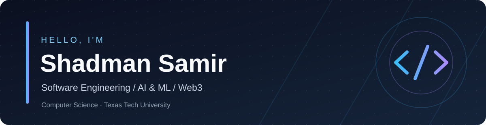

I build software that connects practical problems with thoughtful technical solutions.

---

### 👨‍💻 About me

- 🎓 Studying **Computer Science**, with a **Mathematics minor**, at **Texas Tech University**
- 🔭 Interested in **software engineering, AI/ML, full-stack development, and blockchain**
- 🧠 Enjoy building everything from predictive models to decentralized applications
- 🤝 Open to collaborating on interesting software projects
- ⚽ Outside of coding: soccer, gaming, and exploring new technology

### 🛠️ Tech stack

**Languages**

**Frameworks & tools**

### 🚀 Featured work

| Project | What it does | Stack |
| :--- | :--- | :--- |
| 🔐 **[QCheck](https://github.com/ssamir7007/Qcheck-ethDenver)** | Ethereum-based medicine authenticity verification using QR codes, on-chain registration, and supply-chain tracking. | Next.js, Solidity, Ethers.js |
| 🧪 **[Concrete Strength Predictor](https://github.com/ssamir7007/Concrete-Strength-Predictor)** | Predictive modeling for concrete compressive strength based on mixture data. | Python, Machine Learning |
| 🛒 **[Customer Order System](https://github.com/ssamir7007/Customer-Order-System)** | Console and GUI-based ordering system with accounts, product catalog, shopping cart, and simulated checkout. | Java, Swing |

### 📊 GitHub activity

---

**Always learning. Always building.**

[Explore my repositories →](https://github.com/ssamir7007?tab=repositories)

